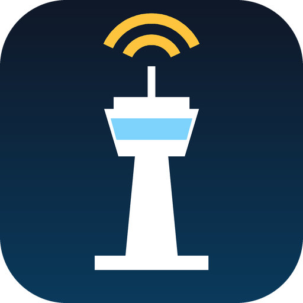
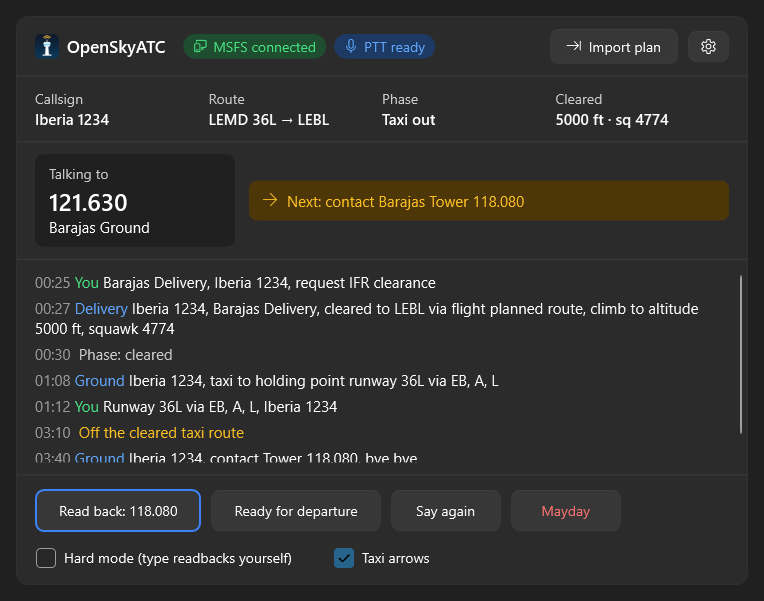
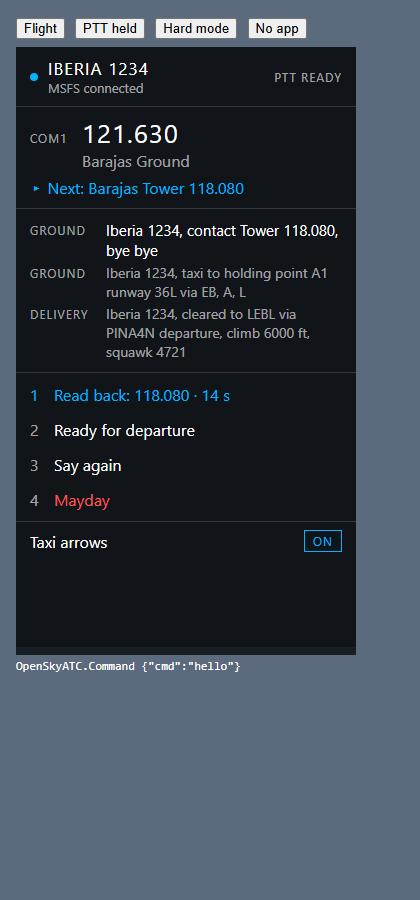
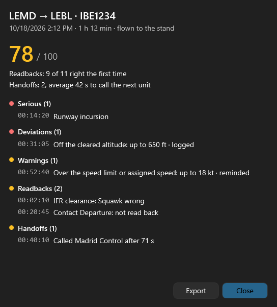

# OpenSkyATC

A free, open-source (GPL-3.0) replacement ATC add-on for **Microsoft Flight Simulator 2024**.

OpenSkyATC is a Windows app that connects to the sim through SimConnect and plays ATC for one IFR flight, gate to gate, with ICAO/European phraseology:

- clearance delivery, push and start (it drives the sim's tug), taxi with in-sim route arrows, tower, departure, centre sectors along your route, approach with vectors, landing and taxi to the stand;
- controller voices (Piper, local) with a radio effect, a fixed voice per controller;
- talk back by voice (Whisper, local, push-to-talk) or with click-to-respond buttons, and a hard mode where you type your readbacks;
- conformance monitoring: altitude, heading, route, speed, squawk, handoffs and runway safety, with warnings that escalate;
- an in-sim toolbar panel (status, frequency, last calls, buttons, taxi-arrows switch);
- an end-of-flight debrief with a score;
- flight plans from SimBrief or an MSFS .pln file; English or Spanish interface (the radio is always English).

Everything runs on your PC. No accounts, no cloud services, no telemetry.



| Toolbar panel in the sim | Debrief |
| --- | --- |
|  |  |

## Status

**0.1.2 preview.** All planned features are built and tested with a simulated pilot; live testing in the sim is in progress (see the checklists in [docs](docs)). Expect rough edges and please report them in [Issues](https://github.com/lgiucleab/OpenSkyATC/issues).

## Install

1. Download `OpenSkyATC-Setup-<version>.exe` from [Releases](https://github.com/lgiucleab/OpenSkyATC/releases) and run it. It installs the app for your Windows user (no administrator rights; .NET and Microsoft's SimConnect library included, no SDK needed) and puts the toolbar panel and taxi-arrow packages in the sim's Community folder (found automatically for the Microsoft Store and Steam versions).
2. Start OpenSkyATC, enter your SimBrief Pilot ID in Settings (or pick a .pln), load a flight in MSFS 2024 at a gate, and press **Import plan**. Voices (about 70 MB each) and the speech model (about 140 MB) download once, on first use.

To uninstall: Start menu > OpenSkyATC > Uninstall OpenSkyATC (or Windows Settings > Apps). It removes the app and both sim packages, and asks whether to delete the downloaded voices, your settings and debriefs.

## Building

Requirements: Windows 10/11 x64, the .NET 10 SDK, and the MSFS 2024 SDK (the build reads the managed SimConnect DLL from it; see [CLAUDE.md](CLAUDE.md) for how it is found).

```
dotnet build
dotnet test
```

Installer: `python installer/build.py` (needs Inno Setup 6: `winget install JRSoftware.InnoSetup`) writes `artifacts/installer/OpenSkyATC-Setup-<version>.exe`.

Design and decisions: [docs/ATC-Brain-Design.md](docs/ATC-Brain-Design.md) (the ATC behaviour) and [docs/decisions.md](docs/decisions.md).

## Licence

GPL-3.0, with an additional permission to link with Microsoft's SimConnect libraries. See [LICENSE](LICENSE), [LICENSE-EXCEPTION.md](LICENSE-EXCEPTION.md) and [THIRD_PARTY_NOTICES.md](THIRD_PARTY_NOTICES.md) (voices, speech model and libraries, with their licences).

The installer includes Microsoft's SimConnect DLLs (unmodified, from the MSFS 2024 SDK, under Microsoft's terms); the source repository does not, so building from source needs your own MSFS 2024 SDK.

OpenSkyATC is not affiliated with Microsoft, Asobo Studio, SimBrief/Navigraph or BeyondATC.
